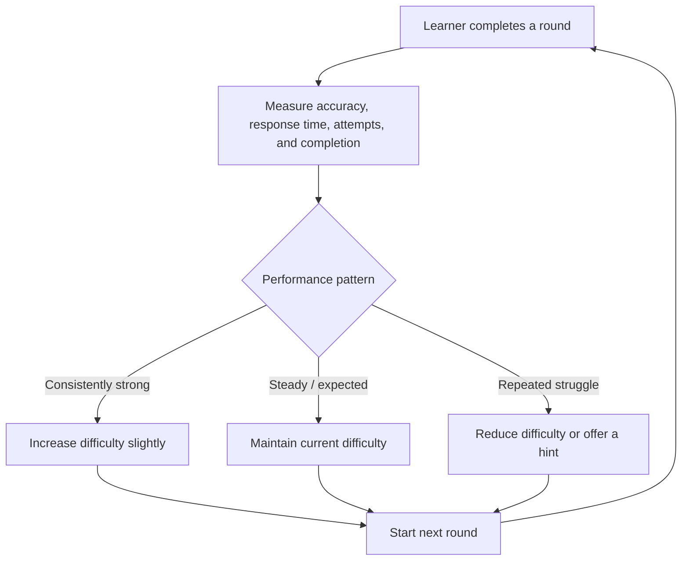
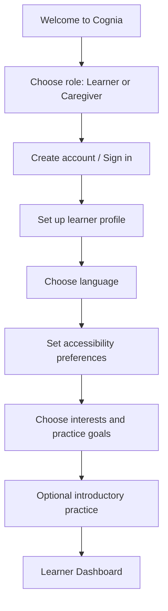
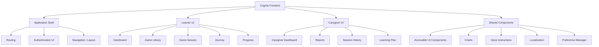
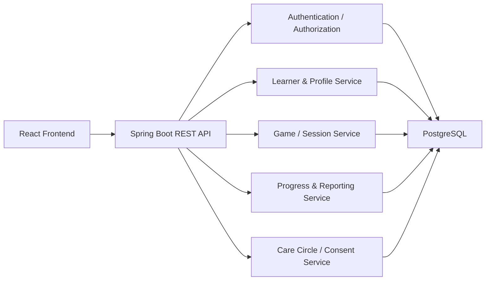

# Cognia — Complete Website Architecture & UX Plan

## 1. Product Overview

**Cognia** is an adaptive cognitive gaming platform designed to support older adults and people with dyslexia through accessible, engaging games. Activities target memory, attention, reading, pattern recognition, processing speed, and listening.

The experience should feel encouraging, calm, and easy to navigate. Difficulty adapts using signals such as accuracy, response time, and performance. Accessibility features include voice instructions, large typography, high contrast, regional languages, and progress views for learners and caregivers.

The website is organized into two experiences:

- **Learner Experience:** focused on games, daily practice, progress, and autonomy.
- **Caregiver Experience:** focused on supportive oversight, practice history, reports, and learning plans, with learner consent.

> Progress metrics are intended to describe gameplay and practice—not to diagnose or replace professional assessment.

---

## 2. High-Level Sitemap

```mermaid
flowchart TD
    A["Cognia Website"] --> B["Public Pages"]
    A --> C["Learner Experience"]
    A --> D["Caregiver Experience"]

    B --> B1["Landing Page"]
    B --> B2["Login / Register"]
    B --> B3["Onboarding"]

    C --> C1["Home / Dashboard"]
    C --> C2["Game Library"]
    C --> C3["Game Detail"]
    C --> C4["Game Session"]
    C --> C5["Session Summary"]
    C --> C6["Daily Journey"]
    C --> C7["My Progress"]
    C --> C8["Care Circle"]
    C --> C9["My Profile"]
    C --> C10["Accessibility & Preferences"]

    D --> D1["Caregiver Overview"]
    D --> D2["Learner Profile"]
    D --> D3["Progress Reports"]
    D --> D4["Session History"]
    D --> D5["Learning Plan"]
    D --> D6["Support & Preferences"]
    D --> D7["Caregiver Settings"]
```



---

## 3. Learner Left Sidebar

The learner sidebar should remain simple and consistent.

### Main navigation

| Sidebar option | Route | Destination |
|---|---|---|
| Home | `/dashboard` | Learner dashboard and recommended next activity |
| Games | `/games` | Searchable and filterable game library |
| Daily Journey | `/journey` | Guided daily sequence of activities |
| My Progress | `/progress` | Learner-facing practice and skill progress |
| Care Circle | `/care-circle` | Consent-based connection with caregivers |
| My Profile | `/profile` | Personal details, interests, and goals |
| Preferences | `/preferences` | Accessibility, language, voice, and gameplay settings |

### Persistent sidebar elements

- Cognia logo and product name.
- Learner profile/avatar and account menu.
- Daily Journey progress indicator.
- Quick voice instruction toggle or voice shortcut.
- Language shortcut.
- Accessibility shortcut.
- Clear active navigation state.
- Collapse/expand option for desktop; drawer behavior on mobile.

**Navigation principle:** keep the learner's navigation uncluttered. Avoid exposing administrative or analytics-heavy controls in the learner sidebar.

---

## 4. Learner Experience — Window Specifications

### 4.1 Home / Learner Dashboard

**Route:** `/dashboard`

#### Purpose
Provide a welcoming starting point and help the learner decide what to do next.

#### Components
- Friendly greeting and current date.
- Learner profile and selected language.
- Prominent **Start Session** button.
- Daily Journey progress, such as `2 of 4 activities completed`.
- Quick statistics:
  - Sessions completed.
  - Practice time.
  - Recent activity.
  - Skills practiced.
- Recommended games based on recent performance.
- Weekly activity chart with clear labels.
- Recent sessions/activity list.
- Resume interrupted session, if available.
- Encouraging personalized suggestion.
- Adaptive recommendation card.

#### Behaviors
- Start Session launches a recommended activity or the Daily Journey.
- Resume returns to a paused session.
- Recommended game cards open their detail page.
- Dashboard metrics should use gentle, non-judgmental language.

---

### 4.2 Game Library

**Route:** `/games`

#### Purpose
Let learners independently explore and select activities.

#### Components
- Search field.
- Category filters:
  - Memory
  - Attention
  - Reading
  - Pattern Recognition
  - Processing Speed
  - Listening
- Difficulty filter, if appropriate.
- Recommended games section.
- Recently played section.
- Game cards.

#### Game card information
- Game title.
- Brief, plain-language description.
- Skill targeted.
- Estimated duration.
- Current or suggested difficulty.
- Accessible thumbnail/icon.
- **Play** or **View Details** action.

#### Behaviors
- Search and filters update the game list.
- The list supports keyboard and screen-reader navigation.
- Game recommendations can be personalized without hiding the full library.

---

### 4.3 Game Detail

**Route:** `/games/:gameId`

#### Purpose
Explain an activity before the learner starts.

#### Components
- Game title and visual preview.
- Simple description of what to do.
- Skill focus.
- Estimated duration.
- Suggested difficulty.
- Voice instruction setting.
- Practice mode option.
- **Start Game** button.
- Optional **How to Play** demonstration.

#### Behaviors
- Instructions can be spoken aloud and repeated.
- Learners can start without a stressful countdown.
- Practice mode can offer a low-pressure first round.

---

### 4.4 Game Session

**Route:** `/session/:sessionId`

The game session should use a focused layout, separate from the full dashboard/sidebar, to reduce distractions.

#### Layout
- Compact header with game title.
- Round or activity progress.
- Instruction area.
- Main game canvas/content.
- Large answer/control buttons.
- Feedback area.
- Pause and exit controls.

#### Features
- Voice instructions and repeat-instruction control.
- Large, high-contrast interaction targets.
- Clear visual feedback.
- Adjustable or reduced motion.
- No unnecessary time pressure.
- Adaptive difficulty based on performance.
- Session metrics captured in the background:
  - Accuracy.
  - Response time.
  - Mistakes or attempts.
  - Completion status.
  - Duration.
  - Difficulty level.

#### Session controls
- Pause.
- Resume.
- Restart (with confirmation if it discards progress).
- Exit to dashboard or journey.
- Repeat instruction.

#### Feedback tone
Use calm and encouraging wording. Avoid harsh red failure states, shame-oriented labels, or competitive pressure.

---

### 4.5 Adaptive Difficulty

Difficulty should be adjusted gradually and transparently enough to feel fair, without making the learner feel judged.



#### Possible adjustment dimensions
- Number of items or choices.
- Sequence length.
- Pattern complexity.
- Reading complexity.
- Pace or response window.
- Hint availability.

#### Guardrails
- Avoid large difficulty jumps.
- Provide a hint or simpler variation before ending an activity.
- Allow the learner to pause, skip, or stop.
- Do not interpret gameplay metrics as a medical diagnosis.

---

### 4.6 Session Summary

**Route:** `/session/:sessionId/summary`

#### Purpose
Close the activity positively and offer a useful next step.

#### Components
- Friendly completion message.
- Accuracy or completion indicator.
- Number of rounds completed.
- Session duration.
- Skill practiced.
- Difficulty level.
- A simple improvement or activity highlight, where supported.
- Suggested next activity.

#### Actions
- **Play Again**
- **Continue Journey**
- **Return Home**
- Optional share-with-caregiver action, subject to consent.

#### Design notes
- Avoid grades, punitive scores, or “failed” language.
- Make metrics understandable and optional where possible.

---

### 4.7 Daily Journey

**Route:** `/journey`

#### Purpose
Provide a guided daily routine with a manageable number of activities.

#### Components
- Daily Journey title and progress.
- Suggested sequence of approximately 3–5 games.
- Activity cards with skill, duration, and status.
- Start/continue journey button.
- Completion summary.

#### Features
- Sequential or flexible activity order.
- Resume after interruption.
- Pause and skip.
- Adaptive game selection.
- Clear completion indicators.
- Optional schedule preferences.

#### Design notes
- Do not make streaks punitive.
- Missing a day should not cause loss of progress or guilt.

---

### 4.8 My Progress

**Route:** `/progress`

#### Purpose
Show the learner how their practice is developing in an accessible, encouraging way.

#### Components
- Overview metrics:
  - Sessions completed.
  - Practice time.
  - Activities completed.
- Skill-wise progress:
  - Memory
  - Attention
  - Reading
  - Pattern Recognition
  - Processing Speed
  - Listening
- Simple trend charts.
- Session history.
- Date range filters.
- Optional achievements.
- Optional report export in a future release.

#### Design notes
- Use large chart labels and readable legends.
- Explain metrics in plain language.
- Clearly distinguish practice trends from clinical assessment.

---

### 4.9 Care Circle

**Route:** `/care-circle`

#### Purpose
Allow learners to connect with trusted caregivers while maintaining control over shared information.

#### Components
- Connected caregiver list.
- Invite caregiver via code or invitation.
- Connection status.
- Shared-progress preferences.
- Remove/disconnect caregiver action.
- Consent and privacy explanation.

#### Features
- Learner-controlled sharing permissions.
- Choose which progress data is shared.
- Clear confirmation before sharing or disconnecting.
- No caregiver access without learner consent and appropriate authorization.

---

### 4.10 My Profile

**Route:** `/profile`

#### Components
- Name and avatar.
- Personal details.
- Interests.
- Practice goals.
- Profile editing.
- Account details and sign-out.

#### Design notes
- Keep forms short and readable.
- Avoid collecting unnecessary personal information.

---

### 4.11 Accessibility & Preferences

**Route:** `/preferences`

Settings should apply consistently throughout the application.

#### Visual accessibility
- Text size: Normal / Large / Extra Large.
- Font choice: system font / dyslexia-friendly font option.
- Increased letter and line spacing.
- High-contrast mode.
- Light or dark theme.
- Reduced motion.
- Larger buttons and touch targets.

#### Voice and language
- Voice instructions on/off.
- Repeat instructions control.
- Speech rate.
- Voice selection, where supported.
- Language selection:
  - English
  - Hindi
  - Marathi
- Regional language support can expand later.

#### Gameplay preferences
- Suggested difficulty.
- Preferred session length.
- Time pressure on/off or reduced.
- Hints enabled.
- Streaks/achievement reminders enabled or disabled.

#### Design notes
- Settings must be persistent.
- Provide a preview where useful.
- Accessibility preferences should be easy to find from every screen.

---

## 5. Caregiver Experience

Caregiver screens should be more information-rich than learner screens, while remaining supportive and easy to understand.

### Caregiver sidebar

| Sidebar option | Route | Destination |
|---|---|---|
| Overview | `/caregiver/dashboard` | Summary of learner activity |
| Learner Profile | `/caregiver/learner` | Learner details and sharing permissions |
| Progress Reports | `/caregiver/reports` | Trends and printable/exportable reports |
| Session History | `/caregiver/sessions` | Detailed activity history |
| Learning Plan | `/caregiver/learning-plan` | Suggested schedule and activity plan |
| Support & Preferences | `/caregiver/support` | Support information and permitted preferences |
| Settings | `/caregiver/settings` | Caregiver account and notifications |

### 5.1 Caregiver Overview

**Route:** `/caregiver/dashboard`

#### Components
- Learner overview card.
- Weekly practice activity.
- Skill overview.
- Recent sessions.
- Learning plan status.
- Supportive recommendations.
- Notifications or reminders, if enabled.

#### Features
- View only information the learner has consented to share.
- Identify practice patterns, not medical conditions.
- Offer supportive next steps.

---

### 5.2 Learner Profile (Caregiver)

**Route:** `/caregiver/learner`

#### Components
- Learner profile details.
- Connection and consent status.
- Shared data permissions.
- Caregiver relationship/details, as applicable.
- Access management.

---

### 5.3 Progress Reports

**Route:** `/caregiver/reports`

#### Components
- Practice metrics.
- Accuracy and completion trends.
- Practice duration.
- Session frequency.
- Skill-wise charts.
- Date range filters.
- PDF export (future or advanced feature).

#### Design notes
- Reports should explain the meaning and limitations of metrics.
- Avoid diagnostic labels.

---

### 5.4 Session History

**Route:** `/caregiver/sessions`

#### Table columns
- Date.
- Game/activity.
- Skill.
- Duration.
- Accuracy or completion.
- Difficulty.
- Status.

#### Features
- Search.
- Date filters.
- Skill/game filters.
- Sort.
- Export (future feature).

---

### 5.5 Learning Plan

**Route:** `/caregiver/learning-plan`

#### Components
- Suggested daily or weekly activity plan.
- Recommended activities.
- Schedule preferences.
- Practice goals.
- Plan status.

#### Features
- Suggestions based on learner activity.
- Caregiver can suggest activities or a schedule.
- Learner retains the ability to skip, pause, or stop.
- Avoid coercive or punitive tracking.

---

### 5.6 Support & Preferences

**Route:** `/caregiver/support`

#### Components
- Accessibility support overview.
- Guidance for helping during practice.
- Shared preferences, where permitted.
- Help and FAQ.
- Contact/support information.

---

### 5.7 Caregiver Settings

**Route:** `/caregiver/settings`

#### Components
- Caregiver profile.
- Notification preferences.
- Account/security settings.
- Connected learners.
- Privacy and sign-out.

---

## 6. Onboarding Flow

Onboarding should be short, friendly, and avoid an intimidating assessment.



### Onboarding principles
- Allow users to skip nonessential steps.
- Explain why each preference is requested.
- Offer voice guidance.
- Use large controls and simple language.
- Do not require a lengthy cognitive assessment.
- Allow settings to be changed later.

---

## 7. Route Architecture

```text
/
├── /login
├── /register
├── /onboarding
│
├── /dashboard
├── /games
│   └── /games/:gameId
├── /session/:sessionId
│   └── /session/:sessionId/summary
├── /journey
├── /progress
├── /care-circle
├── /profile
├── /preferences
│
└── /caregiver
    ├── /caregiver/dashboard
    ├── /caregiver/learner
    ├── /caregiver/reports
    ├── /caregiver/sessions
    ├── /caregiver/learning-plan
    ├── /caregiver/support
    └── /caregiver/settings
```

### Shared application surfaces
- Notifications.
- Help/FAQ.
- Privacy and consent.
- Account menu.
- Accessibility shortcuts.

---

## 8. Design System

### Visual direction
Apple-inspired, premium, minimalist, calm, and approachable.

### Suggested foundations
- **Background:** soft neutral such as `#F5F6F8`.
- **Primary action:** blue such as `#3569E8`.
- **Accent surfaces:** soft mint, lavender, and peach.
- **Typography:** SF/system font stack, with an optional dyslexia-friendly alternative.
- **Cards:** rounded corners around 18–24 px.
- **Sidebar:** around 240–260 px on desktop.
- **Content width:** around 1200 px maximum.
- **Shadows:** subtle and restrained.

### Typography hierarchy
| Element | Suggested size |
|---|---:|
| Page title | 32 px |
| Section title | 22 px |
| Body text | 16–18 px |
| Game instruction | 24–30 px |
| Answer/control button label | 20–24 px |

### Accessibility standards to target
- Strong color contrast.
- Keyboard navigation.
- Visible focus indicators.
- Screen-reader labels.
- Large tap targets.
- No color-only meaning.
- Reduced-motion support.
- Responsive layouts for tablet and mobile.
- Clear and consistent interaction patterns.

---

## 9. MVP vs. Advanced Features

| Feature | MVP | Advanced / Later |
|---|---|---|
| Authentication and learner profile | Yes | Expanded account controls |
| Learner dashboard | Yes | Rich personalization |
| Game library | Yes | More categories and advanced filters |
| Core game sessions | Yes | Larger game catalog |
| Basic adaptive difficulty | Yes | More sophisticated personalization |
| Session summary | Yes | Deeper insights |
| Daily Journey | Yes | Flexible personalized plans |
| Progress dashboard | Basic metrics | Expanded reports and exports |
| Accessibility preferences | Essential settings | Additional customization |
| English, Hindi, Marathi | Initial support as feasible | More regional languages |
| Voice instructions | Basic browser voice | More voice options and quality |
| Care Circle | Consent-based connection | Granular sharing controls |
| Caregiver overview | Basic overview | Advanced dashboards |
| Caregiver session history | Basic history | Search/export refinements |
| PDF reports | — | Later |
| Notifications/reminders | — | Later, opt-in |
| Achievements | Optional/simple | Expanded, non-punitive system |

### Recommended MVP priorities
1. Authentication and onboarding.
2. Learner dashboard.
3. Game library and game detail screens.
4. Working game session engine.
5. Session summary.
6. Basic adaptive difficulty.
7. Daily Journey.
8. Accessible preferences and voice instructions.
9. Learner progress dashboard.
10. Consent-based caregiver overview.

---

## 10. Suggested Technical Architecture

### Frontend modules



### Core application services (frontend conceptual modules)
- **Game Engine:** handles game lifecycle, rounds, interactions, and state.
- **Scoring Module:** computes game-specific score/accuracy and completion.
- **Adaptive Difficulty Module:** recommends difficulty adjustments.
- **Session Manager:** records start, pause, resume, end, and summary.
- **Progress Module:** aggregates learner-facing metrics.
- **Localization Module:** strings and regional language selection.
- **Accessibility Manager:** applies global font, contrast, motion, and control settings.
- **Consent/Sharing Module:** governs caregiver-visible information.

### Future backend architecture

A future backend may use Spring Boot with PostgreSQL.



### Possible domain entities
- User
- LearnerProfile
- CaregiverProfile
- CareCircleConnection
- ConsentPermission
- Game
- GameSession
- SessionRound
- SessionMetric
- LearningPlan
- LearnerPreference
- Achievement (optional)

### Integration considerations
- The current frontend can operate with demo/mock data.
- API integration can be introduced without redesigning the main navigation.
- Keep game logic modular so new games can be added consistently.
- Apply authentication and authorization on the backend, not only in the UI.
- Enforce caregiver access through explicit permissions and server-side checks.

---

## 11. UX Principles & Product Guardrails

1. **Learner autonomy:** learners can pause, skip, or stop.
2. **Supportive feedback:** avoid shame, punitive scores, or harsh failure messaging.
3. **Accessible by default:** readable typography, contrast, voice, and keyboard support.
4. **Low cognitive load:** clear navigation and one primary action per screen.
5. **Privacy and consent:** caregiver visibility is explicit and controlled.
6. **Non-diagnostic metrics:** gameplay trends are not medical assessments.
7. **Gentle personalization:** difficulty changes gradually and can offer hints.
8. **No punitive streaks:** missed practice days should not result in guilt or lost progress.
9. **Responsive design:** learner and caregiver experiences should work on desktop, tablet, and mobile.
10. **Future-ready architecture:** allow backend, localization, and new games to be added progressively.

---

## 12. Recommended Left Navigation Summary

### Learner
- Home
- Games
- Daily Journey
- My Progress
- Care Circle
- My Profile
- Preferences

### Caregiver
- Overview
- Learner Profile
- Progress Reports
- Session History
- Learning Plan
- Support & Preferences
- Settings

**Recommended overall structure:** maintain a lightweight learner interface and a separate, more data-rich caregiver portal. This supports the project's accessibility goals while leaving room for adaptive difficulty, regional language support, and future Spring Boot backend integration.
